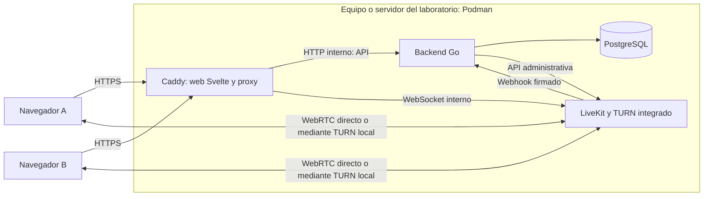

# Spec técnico: aplicación sencilla de videollamadas WebRTC

Versión: 1.2 · Fecha: 21 de octubre de 2026 · Estado: especificación para implementación y pruebas locales.

Documento base: `validación web RTC.md`. Esta revisión aplica las decisiones del usuario: empaquetado con Podman, backend Go, frontend Svelte y ejecución exclusiva en el laboratorio local. Sustituye la arquitectura de despliegue anterior y elimina la entrega de aplicaciones nativas.

Las versiones, límites y valores operativos propuestos se validarán durante la implementación. Este documento no implica que la app esté construida ni que el entorno haya sido instalado.

**Requisito de arquitectura:** backend Go y frontend Svelte deberán aplicar arquitectura hexagonal y Clean Architecture. El dominio y los casos de uso serán independientes de frameworks, transporte, persistencia y SDK multimedia. Las reglas de los pasos 3 y 4 son obligatorias para la implementación.

## Paso 1. Definir el alcance de la app web

**Objetivo:** dos usuarios de laboratorio podrán realizar una videollamada desde el navegador, con audio, cámara y pantalla compartida, mediante una interfaz propia.

Funciones del MVP:

- Inicio de sesión con usuarios locales de prueba.
- Creación de llamada e invitación a otro usuario local mediante enlace.
- Antesala con vista previa y selección de cámara y micrófono.
- Llamada 1:1; encender/apagar cámara, silenciar micrófono y salir.
- Compartir pantalla desde navegadores de escritorio compatibles.
- Espectador opcional, que ocupa uno de los dos lugares y solo recibe medios.
- Estados de conexión, reconexión, errores de permisos y calidad de red.
- Finalización por el creador y auditoría básica.

El alcance es una aplicación web de laboratorio. No incluye aplicaciones nativas, alojamiento externo, publicación en Internet, alta disponibilidad, grabación, chat, archivos ni reuniones grupales. El audio del sistema durante la pantalla compartida no es requisito.

Parámetros iniciales: dos identidades por llamada, duración máxima de 60 minutos y plazo de ingreso de 10 minutos para una llamada vacía. La aceptación funcional empieza con una llamada real entre dos equipos de la LAN. Las 50–200 llamadas del documento original quedan como referencia para pruebas de capacidad opcionales, no como condición de esta entrega sencilla.

**Resultado del paso:** alcance local y criterios de laboratorio definidos.

## Paso 2. Seleccionar el stack y fijar versiones

| Componente | Tecnología | Uso |
| --- | --- | --- |
| Frontend | Svelte + TypeScript + Vite | SPA con interfaz propia y compilación estática. |
| SDK web | `livekit-client` | Señalización, pistas y eventos, encapsulados en un adaptador del frontend. |
| Backend | Go + `fiber` | API, autenticación local y gestión de llamadas. |
| SDK de servidor | SDK oficial LiveKit para Go y paquete de autenticación del protocolo | Gestión administrativa de salas y firma de tokens. |
| Persistencia | PostgreSQL + `pgx/v5` | Usuarios locales, sesiones, llamadas y auditoría. |
| Migraciones | SQL versionado con `golang-migrate` | Creación y actualización del esquema. |
| Medios | Un nodo LiveKit autogestionado local | SFU para audio, cámara y pantalla. |
| TURN | Integrado en LiveKit; habilitación local para pruebas de relé | Diagnóstico y validación de conectividad alternativa. |
| Servidor web y proxy | Caddy con certificados de laboratorio | Archivos estáticos, HTTPS y proxy a API/WSS. |
| Empaquetado | Podman, archivos `Containerfile` y `compose.yaml` | Construcción y ejecución de los servicios locales. |

Usar el [SDK oficial de Go](https://github.com/livekit/server-sdk-go) para evitar implementar el protocolo administrativo. El backend no transporta video. El frontend no requiere SSR ni componentes de React.

No incluir Redis o Dragonfly: el laboratorio usa un único nodo LiveKit, que no requiere esas dependencias. Fuente: [arquitectura de LiveKit](https://docs.livekit.io/reference/internals/livekit-sfu/).

Fijar versiones de Go, Node para compilación, Svelte, SDK y herramientas. Conservar `go.mod`, `go.sum`, el archivo de bloqueo del frontend y versiones o digests de imágenes. No utilizar `latest`.

**Resultado del paso:** stack Go/Svelte/Podman reproducible y sin servicios externos en ejecución.

## Paso 3. Diseñar la arquitectura local



Todos los servicios residen en el mismo equipo de laboratorio o en un servidor local de la LAN. En Windows, los contenedores Linux se ejecutan en la máquina virtual administrada por Podman. Fuente: [Podman Machine](https://docs.podman.io/en/latest/markdown/podman-machine.1.html).

Caddy sirve el resultado compilado de Svelte y enruta `/api` al backend. Un nombre separado, por ejemplo `rtc.webrtc.test`, enruta la señalización WSS a LiveKit. Los medios usan sus propios puertos y no atraviesan la API Go ni el proxy HTTP.

Las direcciones internas de contenedores sirven para comunicación entre servicios. Las URLs y candidatos ICE enviados al navegador deben ser alcanzables desde el equipo del usuario; no entregar nombres como `livekit:7880` al navegador.

**Resultado del paso:** servicios locales y rutas de negocio, señalización y medios claramente identificados.

### 3.1. Reglas compartidas de arquitectura

Clean Architecture define la separación de responsabilidades y la dirección de dependencias; la arquitectura hexagonal expresa entradas y salidas mediante puertos y adaptadores. Se implementará un núcleo por aplicación, dentro del único servicio Go y de la única SPA Svelte.

| Capa | Responsabilidad | Dependencias permitidas |
| --- | --- | --- |
| Dominio | Entidades, valores, reglas e invariantes de negocio. | Tipos propios y utilidades estándar sin efectos externos. |
| Aplicación | Casos de uso, coordinación y contratos de entrada/salida. | Dominio y puertos definidos en esta capa. |
| Adaptadores de entrada | HTTP, webhooks, tareas programadas e interacción de usuario. | Contratos de aplicación y tecnología de entrada. |
| Adaptadores de salida | Persistencia, API remota, SDK multimedia, dispositivos y seguridad técnica. | Puertos de aplicación y tecnología concreta. |
| Composición | Construir dependencias, inyectarlas y gestionar su ciclo de vida. | Las capas necesarias para ensamblar la aplicación. |

Reglas obligatorias:

1. Las dependencias de código apuntan hacia el núcleo. Dominio y aplicación no importan adaptadores ni el punto de composición.
2. Los casos de uso exponen puertos de entrada y consumen interfaces de salida. Inyectar implementaciones mediante constructores o funciones fábrica, sin localizador global de servicios.
3. Traducir los datos en cada frontera: DTO HTTP, filas SQL, eventos LiveKit y modelos de pantalla no sustituyen a las entidades de dominio. Convertir errores técnicos en errores de aplicación y presentarlos desde los adaptadores de entrada.
4. El backend conserva la autoridad sobre autorización y transiciones de llamadas. El frontend representa permisos y experiencia de usuario, sin reemplazar esas validaciones.
5. Crear interfaces para dependencias externas y límites que se sustituyan en pruebas. Evitar repositorios genéricos, clases base e interfaces por entidad sin una necesidad concreta.
6. Mantener las capas dentro de las aplicaciones existentes; no requieren microservicios, un contenedor por capa ni un framework de inyección de dependencias.

### 3.2. Arquitectura del backend Go

El dominio contiene `Call`, `CallMember`, roles, permisos y transiciones válidas. La aplicación implementa `Login`, `Logout`, `CreateCall`, `GetCall`, `IssueJoinToken`, `EndCall`, `HandleMediaEvent` y `ReconcileCalls`.

| Tipo | Puertos / adaptadores propuestos |
| --- | --- |
| Entrada HTTP | Handlers `net/http`: decodifican, validan formato, obtienen la sesión e invocan casos de uso. |
| Entrada de eventos | Webhook: verifica firma, traduce el evento e invoca `HandleMediaEvent`. |
| Entrada programada | Trabajador local: invoca reconciliación y cierre; no modifica tablas directamente. |
| Salida de datos | `UserRepository`, `SessionRepository`, `CallRepository`, `EventRepository` y `UnitOfWork`, implementados con PostgreSQL/pgx. |
| Salida de medios | `RoomService` y `JoinTokenIssuer`, implementados con el SDK LiveKit de Go. |
| Salida de seguridad y tiempo | `PasswordHasher`, `SessionTokenGenerator` y `Clock`, con implementaciones inyectadas. |

Definir puertos de salida en `application/ports` con tipos propios; pueden aceptar `context.Context` para cancelación. No exponer `http.Request`, `pgx.Tx`, estructuras LiveKit ni códigos HTTP al núcleo. Las entidades de dominio no contienen etiquetas JSON o de persistencia para satisfacer a un adaptador.

Los casos de uso definen qué operaciones son atómicas. `UnitOfWork` ejecuta la transacción y entrega repositorios vinculados a ella. Guardar `ENDING` y la tarea de cierre en la misma transacción; la llamada al servidor de medios queda fuera de esa transacción SQL y se coordina mediante la tarea persistida y reintentos idempotentes.

`cmd/server` ensambla configuración, conexiones, adaptadores y casos de uso; registra handlers y gestiona apagado. Los handlers no contienen SQL, reglas de pertenencia ni llamadas directas al SDK. Flujo de ejemplo: handler de token → `IssueJoinToken` → repositorio y política de acceso → puertos de sala/firma → resultado de aplicación → DTO HTTP.

### 3.3. Arquitectura del frontend Svelte

El dominio del frontend contiene tipos propios de participante, permisos, estado de llamada y publicación. La aplicación implementa `SignIn`, `LoadCall`, `PrepareDevices`, `JoinCall`, `SetMicrophoneEnabled`, `SetCameraEnabled`, `StartScreenShare`, `StopScreenShare`, `LeaveCall` y `EndCall`.

| Tipo | Puertos / adaptadores propuestos |
| --- | --- |
| Entrada de usuario | Componentes y controladores de presentación Svelte: invocan casos de uso y muestran resultados. |
| Salida HTTP | `AuthGateway` y `CallGateway`, implementados con `fetch`; encapsulan cookies, CSRF, DTO y errores HTTP. |
| Salida de medios | `MediaSession`, implementado con `livekit-client`; encapsula conexión, publicación, suscripción y traducción de eventos. |
| Salida de dispositivos | `DeviceAccess`, implementado con APIs del navegador o utilidades del SDK para vista previa y selección. |
| Presentación de estado | Presenter/store Svelte: transforma snapshots y eventos de aplicación en el modelo de pantalla. |

Dominio y aplicación son TypeScript independiente: no importan Svelte, stores/runes, `livekit-client`, ni utilizan `fetch`, `window`, `document` o `navigator`. Sus contratos no exponen tipos DOM o del SDK. `MediaSession` entrega eventos propios como `ConnectionChanged`, `ParticipantUpdated` y `TrackStateChanged`, con identificadores y valores simples.

Las pistas y elementos HTML permanecen en la capa externa. Un adaptador de renderizado vincula identificadores de pista con elementos de audio/video mediante componentes de presentación especializados. Se ensambla en la composición y no atraviesa el núcleo. Los componentes de pantalla no crean conexiones, consultan la API directamente ni llaman al SDK.

La aplicación coordina el estado de sesión y el store Svelte lo refleja para la vista; no mantener dos máquinas de estados independientes. El adaptador multimedia posee la instancia del SDK y sus listeners. El caso de uso de salida dispone su limpieza y la vista retira sus suscripciones al desmontarse.

Para compartir pantalla, conservar la activación del usuario: el clic invoca el caso de uso y este llama al puerto de captura inmediatamente, antes de cualquier espera de red o temporizador. Los permisos de aplicación ya deben estar disponibles. Las capas no deben romper el diálogo de captura del navegador.

`src/composition` ensambla gateways HTTP, adaptadores de medios/dispositivos, casos de uso y presentación. Flujo: botón «Unirse» → `JoinCall` → `CallGateway` para autorización → `MediaSession` para conectar → eventos propios → presenter/store → vista. El backend conserva la decisión definitiva de acceso.

**Criterio de arquitectura:** los casos de uso de ambas aplicaciones deben poder probarse con adaptadores falsos, sin iniciar PostgreSQL, LiveKit, el servidor HTTP ni una interfaz Svelte.

## Paso 4. Preparar el repositorio y el empaquetado Podman

Estructura de referencia para respetar los límites de arquitectura. Si el repositorio usa otra raíz, conservar esta separación y documentar la correspondencia:

```text
apps/api/cmd/server/                       Composición y ciclo de vida del servicio Go
apps/api/internal/domain/                  Entidades, valores y reglas
apps/api/internal/application/ports/       Contratos de entrada y salida
apps/api/internal/application/usecases/    Casos de uso
apps/api/internal/adapters/in/http/        Handlers y DTO HTTP
apps/api/internal/adapters/in/webhooks/    Validación y traducción de eventos
apps/api/internal/adapters/in/jobs/        Activación de tareas periódicas
apps/api/internal/adapters/out/postgres/   Repositorios y transacciones pgx
apps/api/internal/adapters/out/livekit/    Salas y emisión de tokens
apps/api/internal/adapters/out/security/   Hash y generación de credenciales
apps/api/internal/adapters/out/clock/      Reloj del sistema
apps/api/migrations/                       Migraciones SQL
apps/api/Containerfile                     Compilación y ejecución de Go
apps/web/src/domain/                       Modelos y reglas propias del frontend
apps/web/src/application/ports/            Contratos de API, medios y dispositivos
apps/web/src/application/usecases/         Casos de uso independientes de Svelte
apps/web/src/adapters/http/                Gateways con fetch y traducción de DTO
apps/web/src/adapters/livekit/             Sesión multimedia y traducción de eventos
apps/web/src/adapters/browser/             Dispositivos y renderizado de pistas
apps/web/src/presentation/                 Componentes, presenters y stores Svelte
apps/web/src/composition/                  Ensamblado de dependencias del frontend
apps/web/src/main.ts                       Arranque del punto de composición
apps/web/Containerfile                     Compilación de la SPA y servicio Caddy
infra/compose.yaml                         Servicios, redes, volúmenes y puertos Podman
infra/Caddyfile                            Web, API, WSS y TLS local
infra/livekit.yaml                         Configuración local del SFU y TURN
infra/.env.example                         Variables sin secretos
tests/                                    Integración, navegación y laboratorio
docs/arquitectura.md                       Puertos, dependencias y decisiones
docs/laboratorio.md                        Instalación, arranque, diagnóstico y parada
```

Construir imágenes multietapa: Node solo compila la web; el servicio final sirve archivos estáticos. Go se compila en una etapa de construcción y se ejecuta como binario en una imagen mínima compatible. Incluir certificados raíz cuando el binario deba realizar conexiones TLS.

Servicios permanentes: `web`, `api`, `postgres` y `livekit`. Las migraciones y la creación de usuarios de prueba se ejecutan como tareas de una sola ejecución. Usar volúmenes nombrados para PostgreSQL y la CA local/certificados. Montar configuración de solo lectura y usar secretos de Podman o archivos locales protegidos excluidos del repositorio.

Seleccionar explícitamente `podman-compose` como proveedor de `podman compose`, fijar su versión y verificar su compatibilidad con el archivo. El comando es un envoltorio de un proveedor externo; no basta con asumir que Podman lo incluye. Fuente: [Podman Compose](https://docs.podman.io/en/v5.6.2/markdown/podman-compose.1.html).

Configuración mínima:

| Variable | Uso en laboratorio |
| --- | --- |
| `APP_BASE_URL` | Ejemplo LAN: `https://webrtc.test:8443`. |
| `ALLOWED_WEB_ORIGINS` | Orígenes completos y exactos del laboratorio. |
| `DATABASE_URL` | Conexión interna a `postgres:5432`. |
| `LIVEKIT_URL` | Ejemplo LAN: `wss://rtc.webrtc.test:8443`. |
| `LIVEKIT_API_URL` | URL interna, por ejemplo `http://livekit:7880`. |
| `LIVEKIT_API_KEY`, `LIVEKIT_API_SECRET` | Claves locales exclusivas del servidor. |
| `LAB_HOST_IP` | IP alcanzable del host o VM local; generar con ella la configuración ICE aplicable. |
| `AUTH_MODE` | `local`. |
| `CALL_MAX_DURATION_SECONDS` | Propuesta: 3600. |
| `JOIN_TOKEN_TTL_SECONDS` | Propuesta: 120 para la credencial inicial. |

Estas variables son el contrato del proyecto; no todas son variables nativas de LiveKit. El arranque debe generar o cargar la configuración correspondiente y fallar claramente si faltan valores. No colocar secretos en variables públicas de Vite.

Preparar dos perfiles documentados:

1. **Mismo equipo:** dos navegadores o perfiles independientes, con nombres locales resueltos a loopback. Usar HTTPS local para conservar el mismo esquema de sesión segura.
2. **LAN:** dos equipos distintos; nombres resueltos a la IP alcanzable del servidor, certificados confiables en ambos y puertos de medios accesibles.

La descarga inicial de dependencias e imágenes puede requerir Internet. Una vez preparadas, la app y las llamadas deben operar localmente, sin identidad, TURN, STUN, CDN o API externa obligatorios.

**Resultado del paso:** empaquetado Podman definido, configuración por perfil y arranque local reproducible.

## Paso 5. Implementar autenticación local y permisos

Crear al menos tres usuarios ficticios mediante una tarea de inicialización: dos para la llamada y uno para pruebas de rechazo. Las contraseñas se proporcionan en la preparación del laboratorio y se almacenan con hash adaptativo, por ejemplo bcrypt. No usar contraseñas universales incorporadas al código ni registro público.

El backend Go implementará login, logout y consulta de sesión. Usar un identificador aleatorio opaco en cookie `HttpOnly`, `Secure`, `SameSite=Lax`, con caducidad; guardar su hash y vencimiento en PostgreSQL. Proteger las mutaciones con CSRF y validación de origen, limitar intentos de login e invalidar la sesión al salir.

Servir la API bajo el mismo origen de la web. El creador selecciona otro usuario local de una lista mínima y obtiene un enlace `/calls/{call_id}`. El receptor debe autenticarse y ser miembro autorizado; el enlace no incluye tokens LiveKit.

| Rol | Entrar/recibir | Publicar cámara y micrófono | Publicar pantalla | Finalizar para todos |
| --- | --- | --- | --- | --- |
| Creador | Sí | Sí | Sí | Sí |
| Participante | Sí | Sí | Sí | No |
| Espectador | Sí | No | No | No |

El servidor determina identidad, sala y permisos desde la sesión y los datos persistidos. Una identidad tendrá una conexión activa prevista por llamada. Probar otra pestaña con la misma identidad y explicar si el SDK reemplaza la conexión anterior.

**Resultado del paso:** autorización independiente de servicios corporativos, con usuarios locales y pruebas de acceso indebido.

## Paso 6. Crear el modelo de datos y el ciclo de vida

| Entidad | Campos mínimos |
| --- | --- |
| `users` | `id`, `username` único, `display_name`, `active`, `created_at`. |
| `auth_sessions` | `id`, `user_id`, `session_token_hash` único, `csrf_secret`, `expires_at`, `revoked_at`. |
| `calls` | `id` UUID, `room_name` único, `owner_id`, `status`, `created_at`, `join_deadline`, `started_at`, `ended_at`, `max_duration_seconds`, `version`. |
| `call_members` | `call_id`, `user_id`, `role`, `allowed_sources`, `revoked_at`; unicidad por llamada/usuario. |
| `call_sessions` | `id`, `call_id`, `user_id`, `participant_sid`, `room_sid`, `joined_at`, `left_at`, `disconnect_reason`. |
| `call_events` | `id`, `call_id`, `event_type`, `actor_id`, `occurred_at`, `provider_event_id` único cuando exista, detalles mínimos. |
| `outbox_jobs` | `id`, `call_id`, `operation`, `attempts`, `next_attempt_at`, `completed_at`. |

Guardar fechas en UTC. No almacenar tokens ni contenido de audio/video en estas tablas.

Estados de negocio: `CREATED → ACTIVE → ENDING → ENDED`; una llamada nunca iniciada podrá pasar a `CANCELLED`. `ACTIVE` se establece al confirmar conexión de medios del primer participante. Los errores temporales de infraestructura no deben reabrir una llamada terminada.

Crear llamadas y participantes en una transacción. Serializar emisión de credenciales y cierre sobre el registro de llamada. El trabajo de cierre en `outbox_jobs` se guarda en la misma transacción que `ENDING`, para poder reintentarlo tras un reinicio. Un proceso periódico cancela llamadas vencidas, finaliza las que superen su duración y reconcilia el estado con LiveKit.

Propuesta de retención local: 30 días de auditoría técnica, configurable. Usar datos ficticios. Documentar cómo respaldar los resultados y reiniciar los datos del laboratorio de forma explícita.

**Resultado del paso:** migraciones, restricciones y transiciones verificables.

## Paso 7. Construir los contratos HTTP

Los endpoints de llamadas requieren sesión válida y autorización sobre la llamada. Login valida credenciales; el webhook usa firma del proveedor y los endpoints de salud solo devuelven información técnica mínima. Documentar los contratos en OpenAPI y mantenerlos sincronizados con los handlers Go.

| Método y ruta | Entrada / respuesta | Regla |
| --- | --- | --- |
| `POST /api/v1/auth/login` | `{ username, password }` → sesión mediante cookie | Valida credenciales, limita intentos y protege contra login CSRF. |
| `POST /api/v1/auth/logout` | `204` | Invalida sesión y cookie; requiere CSRF. |
| `GET /api/v1/auth/me` | Usuario actual y token CSRF | Requiere sesión válida. |
| `GET /api/v1/users` | Identificador y nombre de usuarios locales activos | Solo autenticados; no expone hashes o sesiones. |
| `POST /api/v1/calls` | `{ inviteeUserId, inviteeRole }` → `201 { callId, joinUrl, status }` | Crea los dos miembros; admite `Idempotency-Key`. |
| `GET /api/v1/calls/{id}` | `200 { callId, status, role, permissions, joinDeadline }` | Solo miembros. |
| `POST /api/v1/calls/{id}/join-token` | Sin identidad ni sala en el cuerpo → credenciales | Revalida estado, pertenencia y permisos en cada solicitud. |
| `POST /api/v1/calls/{id}/end` | `202 { status: "ENDING" }` | Solo creador; repetible sin duplicar efectos. |
| `POST /api/v1/webhooks/livekit` | Evento firmado → `204` después de persistirlo | Autenticación del proveedor; no usa cookie de usuario. |
| `GET /health/live` y `/health/ready` | Estado técnico mínimo | La preparación comprueba dependencias; no revela secretos. |

Respuesta propuesta de `join-token`:

```json
{
  "callId": "<uuid>",
  "roomName": "call_<uuid>",
  "serverUrl": "wss://rtc.webrtc.test:8443",
  "participantToken": "<jwt-temporal>",
  "expiresAt": "<fecha-ISO-8601-UTC>",
  "permissions": {
    "publishCamera": true,
    "publishMicrophone": true,
    "publishScreen": true,
    "subscribe": true
  }
}
```

Usar `Cache-Control: no-store` para las credenciales. El JWT restringirá `roomJoin` a una sala, permitirá suscripción y limitará publicación por fuentes. Deshabilitar publicación de datos si no se usa. No conceder administración de salas al cliente. La traducción de estos campos a grants debe realizarse con el SDK oficial y comprobarse contra la versión fijada.

Errores con formato `{ "code": "CALL_ENDED", "message": "La llamada terminó", "requestId": "..." }`: `401` sesión inválida, `403` operación no permitida, `404` llamada inexistente o no visible, `409` conflicto de estado, `410` llamada terminada para un miembro autorizado, `429` límite de solicitudes y `503` dependencia no disponible.

**Resultado del paso:** API documentada y pruebas de autorización, idempotencia y concurrencia.

## Paso 8. Integrar salas, tokens y cierre efectivo

Secuencia de entrada:

1. Validar usuario, miembro y estado de llamada en el backend.
2. Crear o asegurar la sala con nombre único y límite de dos participantes antes de emitir el token.
3. Configurar también el límite predeterminado de sala en el servidor y comprobar su comportamiento si LiveKit recrea una sala automáticamente.
4. Firmar credenciales mínimas y devolverlas al cliente.
5. Conectar el SDK, publicar las pistas autorizadas y suscribirse a las remotas.

La API de salas permite establecer límites de participantes y tiempos de espera. La creación automática de salas hace necesario probar también el escenario de recreación. Fuentes: [gestión de salas](https://docs.livekit.io/intro/basics/rooms-participants-tracks/rooms/) y [CLI de salas](https://docs.livekit.io/reference/developer-tools/livekit-cli/rooms/).

**Precisiones frente al documento base:** la expiración del token inicial no debe provocar una desconexión programada de una llamada sana. LiveKit renueva credenciales durante la sesión. Ante una reconexión que requiera nueva autorización de la aplicación, pedir otro token al backend y volver a validar acceso. En autogestión, expulsar a alguien o cambiar permisos no invalida automáticamente sus tokens; el TTL corto reduce exposición, pero no ofrece revocación inmediata. Fuente: [ciclo de tokens y grants](https://docs.livekit.io/frontends/reference/tokens-grants/).

Para finalizar: guardar `ENDING`, denegar nuevos tokens y ejecutar `DeleteRoom` con reintentos. Marcar `ENDED` al confirmar la eliminación o ausencia de sala. El cliente libera dispositivos al recibir la desconexión y consulta el estado para explicar el motivo. Como respaldo, consultar el estado cada 10 segundos mientras esté visible y al recuperar el foco; una desconexión de UI no sustituye la expulsión del servidor.

**Limitación que se medirá en laboratorio:** un token emitido o renovado puede permitir regresar o recrear una sala después del cierre en LiveKit autogestionado. Probar y registrar esa ventana, sin afirmar que `DeleteRoom`, un webhook o bloquear nueva emisión la eliminan. La entrega actual verifica la expulsión de conexiones y el rechazo de nuevas credenciales; la revocación inmediata de todos los tokens ya emitidos queda identificada como limitación. No se incorpora otro servicio para resolverla en esta fase local.

**Resultado del paso:** conexión 1:1 y cierre del transporte probados, con evidencia separada de la política de reentrada.

## Paso 9. Construir la interfaz propia

Implementar en la capa de presentación Svelte una pantalla de login y tres vistas de llamada: entrada, antesala y sala. Los componentes invocan casos de uso y consumen el presenter/store según el paso 3.3. Mantener una única instancia del SDK por llamada dentro del adaptador multimedia, con limpieza de pistas y suscripciones al salir. Mostrar el enlace de invitación al creador y distinguir claramente «Salir» de «Finalizar para todos».

| Estado | Comportamiento esperado |
| --- | --- |
| Antesala | Vista previa local; selección de dispositivos; no publicar antes de unirse. |
| Permiso denegado o dispositivo ausente | Explicación y opción de escuchar o continuar con los medios disponibles, según el rol. |
| Conectando | Deshabilitar uniones repetidas y mostrar progreso. |
| En llamada | Video remoto, vista local sin reproducción de su propio audio y controles accesibles. |
| Cámara apagada / micrófono silenciado | Reflejar estado real de pistas y eventos del SDK. |
| Pantalla compartida | Priorizar la pantalla remota y conservar las cámaras como miniaturas. |
| Red degradada / reconectando | Mensaje visible; reducir video antes de sacrificar audio cuando sea posible. |
| Acceso rechazado / finalizada | Detener captura, liberar recursos y explicar la causa. |

Invocar los casos de uso de cámara, micrófono y pantalla; sus puertos delegan las operaciones técnicas al adaptador del SDK. Al apagar cámara, detener captura según la API seleccionada y comprobar que no se transmite video útil; ocultar el elemento visual no es suficiente. Al salir, desconectar, detener pistas de antesala/publicación y retirar listeners.

Compartir pantalla debe partir de un clic y del selector del navegador. Cancelar ese selector no termina la llamada. Si el usuario deja de compartir desde el navegador, actualizar el botón y retirar la pista. No volver a compartir automáticamente después de una reconexión si se requiere un nuevo permiso. Fuente: [captura de pantalla en MDN](https://developer.mozilla.org/en-US/docs/Web/API/MediaDevices/getDisplayMedia).

Priorizar Chrome y Edge de escritorio en el laboratorio Windows; comprobar Firefox y, si se dispone de macOS, Safari. Registrar versiones exactas y marcar como no probados los navegadores sin equipo disponible. Incluir botón «Activar audio» cuando autoplay esté bloqueado. Los controles deben funcionar con teclado y tener etiquetas accesibles.

**Resultado del paso:** llamada completa desde dos dispositivos, con permisos y fallos de red visibles.

## Paso 10. Configurar HTTPS local, red Podman y medios

Para la LAN, resolver `webrtc.test`, `rtc.webrtc.test` y, si se activa, `turn.webrtc.test` mediante DNS local o archivos hosts de cada equipo. No requieren registro ni DNS público. Usar una CA de laboratorio, por ejemplo la CA interna de Caddy, e instalar únicamente su certificado raíz público en los clientes de prueba. La clave privada de la CA permanece en el host. Los certificados deben cubrir los nombres utilizados.

Cámara y micrófono requieren contexto seguro. El navegador contempla excepciones para loopback/localhost, pero `http://192.168.x.x` no hereda esa excepción. El perfil de aceptación usará HTTPS local y verificará `window.isSecureContext`; no se aceptará deshabilitar la seguridad del navegador. Fuente: [contextos seguros en MDN](https://developer.mozilla.org/en-US/docs/Web/Security/Defenses/Secure_Contexts).

| Puerto / protocolo | Uso y exposición local |
| --- | --- |
| TCP 8443 | HTTPS/WSS en Caddy; loopback en perfil de un equipo, IP LAN en perfil compartido. |
| TCP 8080 | API Go interna entre contenedores; no publicar al host. |
| TCP 7880 | Señalización/API LiveKit interna, detrás del proxy. |
| TCP 7881 | ICE/TCP, accesible desde los clientes de laboratorio cuando se habilite. |
| UDP 7882 | Opción elegida para ICE/UDP mux; publicar y enrutar explícitamente. |
| UDP 3478 | TURN/UDP local si se habilita. |
| TCP 5349 | TURN/TLS local si se habilita, con certificado confiable para su nombre. |
| TCP 5432 | PostgreSQL interno; no publicarlo a la LAN. |

Configurar `rtc.udp_port: 7882`; con UDP mux no se utiliza el rango de puertos RTP alternativo. Los puertos TURN indicados deben coincidir con los anunciados por el servidor. Esta configuración valida el laboratorio, no todas las redes restrictivas posibles. Fuente: [puertos de LiveKit](https://docs.livekit.io/transport/self-hosting/ports-firewall/).

En Windows verificar toda la ruta: navegador → firewall de Windows → red de Podman Machine → publicación del puerto → contenedor. El acceso TCP a la web no demuestra acceso UDP a los medios. No asumir que `network_mode: host` dentro de la VM expone los puertos directamente en la LAN de Windows. Registrar el proveedor y modo de red de Podman Machine utilizado.

Configurar el candidato anunciado por LiveKit con una IP alcanzable y puertos realmente encaminados; no anunciar la IP privada del contenedor ni detectar obligatoriamente una IP pública con un servicio externo. Validar el par ICE seleccionado y el tráfico real. Si el modo de red de Windows no permite la ruta UDP requerida, ajustar la red local o ejecutar los mismos contenedores en un equipo/VM Linux local con conectividad LAN verificable. Documentar el resultado de cada perfil, sin ocultar un fallo UDP con una prueba exclusivamente TCP.

Permitir en el firewall solo la subred de laboratorio. Aplicar lista exacta de orígenes en la API y en el acceso WSS web, y evitar una ruta directa al puerto interno que eluda esas reglas. CORS y `Origin` son controles complementarios: un cliente externo puede falsificar el encabezado, por lo que la autorización por usuario/sala sigue siendo necesaria.

Proteger contra CSRF y XSS, omitir credenciales en logs y guardar tokens de medios solo en memoria del navegador. HTTPS/WSS y cifrado de transporte WebRTC no equivalen a E2EE adicional entre participantes.

**Resultado del paso:** dos equipos acceden por HTTPS confiable e intercambian medios por rutas locales comprobadas.

## Paso 11. Incorporar eventos y diagnóstico de laboratorio

Enviar los webhooks desde LiveKit a la dirección interna del backend, por ejemplo `http://api:8080/api/v1/webhooks/livekit`; no requieren un endpoint público. Validar la firma con el SDK Go sobre el cuerpo original y deduplicar por identificador del evento antes de actualizar datos.

Los webhooks pueden perderse pese a los reintentos. Reconciliar salas y participantes con la API administrativa y comparar también `room_sid` para distinguir instancias recreadas. Fuente: [webhooks y eventos](https://docs.livekit.io/intro/basics/rooms-participants-tracks/webhooks-events/).

Ejecutar el trabajador de cierres y reconciliación como una goroutine del único servicio Go, con cancelación por contexto y apagado ordenado. Respaldar tareas pendientes en `outbox_jobs` para recuperarlas tras un reinicio; no agregar otro sistema de colas.

Registrar localmente llamadas activas, tiempo hasta audio/video, reconexiones, errores de tokens y cierres, par ICE, uso de relé, RTT, pérdida de paquetes y bitrate. Usar `podman stats` para CPU/memoria y las estadísticas del SDK/navegador para medios. Los logs estructurados incluyen `call_id` y `request_id`, sin tokens ni contraseñas.

Guardar un informe de resultados por ejecución. Un panel de monitorización permanente y alertas externas no forman parte de la entrega.

**Resultado del paso:** diagnóstico local suficiente para explicar una llamada fallida y recuperar cierres pendientes.

## Paso 12. Ejecutar las pruebas locales

| Prueba | Criterio de aceptación |
| --- | --- |
| Arranque desde cero | Construir, migrar, inicializar usuarios y arrancar mediante Podman siguiendo la guía. |
| Dos sesiones en un equipo | Usuarios diferentes, audio/video recibido y controles funcionales; usar auriculares para evitar realimentación. |
| Dos equipos LAN | Una llamada real de al menos 15 minutos con medios bidireccionales y HTTPS confiable. |
| Controles y pantalla | El otro usuario observa silencio, cámara apagada y pantalla; cancelar el selector no termina la llamada. |
| Permisos denegados | La app explica el problema y permite los medios disponibles según el rol. |
| Espectador | Recibe medios; el servidor rechaza publicación. |
| Tercer usuario / otra sala | No obtiene token ni acceso; probar carreras de entrada. |
| Token inválido o vencido al conectar | Acceso rechazado y error comprensible. |
| Origen no permitido | Rechazo web; con origen falsificado siguen vigentes las reglas de identidad/sala. |
| Cierre | Expulsa las conexiones, libera dispositivos y deniega nuevos tokens. Registrar aparte la reutilización de credenciales antiguas del paso 8. |
| Pérdida de red | Tras un corte de 10 segundos, recuperación o error explícito, sin duplicar pistas. |
| Ruta UDP | Par ICE y estadísticas confirman medios; no basta el establecimiento WSS. |
| TURN local | Forzar política de relé en el cliente de prueba y comprobar candidato relay y medios; repetir con UDP bloqueado para TURN/TLS. |
| Reinicio de API / LiveKit | Sin reapertura del estado de negocio terminado; recuperación de tareas y explicación del fallo al usuario. |
| Webhooks duplicados / ausentes | No duplican auditoría; la reconciliación corrige ausencias. |
| Operación sin Internet | Con imágenes y dependencias ya preparadas, la llamada LAN funciona sin servicios externos. |
| Parada y nuevo arranque | Conserva datos y CA en volúmenes; no requiere borrar el laboratorio. |

Ejecutar pruebas de autorización, sesiones, estados y concurrencia con las herramientas de Go; integración con PostgreSQL y LiveKit locales; y pruebas de interfaz con herramientas compatibles con Svelte. Complementar la automatización con cámara, micrófono y pantalla reales.

Verificación obligatoria de arquitectura hexagonal y Clean Architecture:

- Probar dominio y aplicación Go con repositorios, reloj y servicios de medios falsos; cubrir acceso rechazado, transición de cierre y reintento sin duplicar efectos.
- Probar los casos de uso TypeScript sin navegador ni Svelte, con gateways y sesión multimedia falsos; cubrir fallo de autorización, reconexión, cancelación de pantalla y limpieza al salir.
- Probar por separado los adaptadores reales: persistencia/transacciones, mapeo HTTP, firmas, traducción de eventos y vinculación de pistas con la vista.
- Incorporar al comando de validación del proyecto una comprobación automática de dependencias: en Go, inspeccionar imports de paquetes; en TypeScript, aplicar restricciones de imports y resolución de alias. Rechazar dependencias del núcleo hacia adaptadores, frameworks o SDK y evitar accesos directos desde la presentación a HTTP/LiveKit.
- Revisar que los puertos no filtren tipos SQL, HTTP, DOM o LiveKit al núcleo y que sustituir un adaptador falso por uno real solo cambie el ensamblado, no los casos de uso.

Para caracterización opcional, medir 1, 5 y 10 llamadas simultáneas según el hardware disponible. Registrar CPU, RAM, resolución, bitrate, latencia y pérdida de paquetes; el generador de carga también consume recursos, por lo que conviene separarlo del servidor al medir capacidad. No extrapolar estas pruebas a 200 llamadas.

Registrar tiempo hasta medios remotos y tiempo de recuperación. Como referencias iniciales de laboratorio, buscar menos de 5 segundos para conectar, excluyendo interacción con permisos, y menos de 15 segundos para recuperar después de restablecer la red. No son cifras garantizadas antes de medir.

**Resultado del paso:** informe de funcionamiento, compatibilidad, rutas de medios y límites del equipo utilizado.

## Paso 13. Integrar y entregar el laboratorio

Secuencia que deberá incluir la guía:

1. Comprobar Podman y el proveedor `podman-compose`. En Windows, inicializar Podman Machine solo si no existe y arrancarla si está detenida.
2. Copiar `infra/.env.example` a un archivo local excluido del repositorio y completar IP, nombres y secretos de prueba.
3. Elegir perfil de un equipo o LAN, configurar resolución de nombres y preparar certificados.
4. Construir las imágenes con Podman, iniciar PostgreSQL y esperar su disponibilidad.
5. Ejecutar migraciones y carga idempotente de usuarios ficticios con tareas del proyecto.
6. Arrancar web, API y LiveKit. La API debe reintentar conexiones transitorias y publicar su estado de preparación; el orden de arranque de contenedores por sí solo no garantiza disponibilidad.
7. Instalar la CA pública en los clientes de prueba, verificar HTTPS y comprobar los candidatos ICE anunciados.
8. Iniciar sesión con dos usuarios, crear la llamada y abrir el enlace en el segundo navegador/equipo.
9. Ejecutar el paso 12 y guardar resultados junto con versiones, configuración de red y recursos del host.
10. Detener con conservación de volúmenes. La eliminación de datos se documentará como una acción separada y explícita.

Comandos orientativos para el archivo que se implementará:

```powershell
# En Windows, consultar primero la máquina existente.
podman machine list
# Ejecutar init solo si no existe una máquina; start solo si está detenida.
podman machine init
podman machine start

# Proveedor previamente instalado y con versión registrada.
$env:PODMAN_COMPOSE_PROVIDER = "podman-compose"
podman compose --env-file infra/.env -f infra/compose.yaml build
podman compose --env-file infra/.env -f infra/compose.yaml up -d postgres
# Aquí se ejecutarán las tareas de migración e inicialización definidas por el proyecto.
podman compose --env-file infra/.env -f infra/compose.yaml up -d
podman compose --env-file infra/.env -f infra/compose.yaml ps
podman compose --env-file infra/.env -f infra/compose.yaml logs api livekit
podman compose --env-file infra/.env -f infra/compose.yaml down
```

Estos comandos describen el flujo esperado: el archivo Compose, los Containerfiles y las tareas se crearán durante la implementación. No se presentan como archivos ya existentes. En Linux nativo se omiten los pasos de Podman Machine.

Entregables: código Svelte y Go organizado con arquitectura hexagonal y Clean Architecture, Containerfiles, Compose compatible con Podman, configuración local, migraciones, inicialización de usuarios, OpenAPI, guía de laboratorio y reporte de pruebas. Incluir `docs/arquitectura.md` con capas, puertos, adaptadores, puntos de composición y reglas de dependencias de ambas aplicaciones, junto con los controles automáticos y sus resultados. Documentar cómo confiar y retirar la CA de laboratorio, conservar/restaurar datos y diagnosticar medios bloqueados.

**Resultado del paso:** app web sencilla ejecutable y verificable íntegramente en el entorno local.

## Orden de ejecución y definición de terminado

| Hito | Pasos | Evidencia |
| --- | --- | --- |
| Base local | 1–6 | Alcance, capas y puertos de ambas aplicaciones, stack, Podman, usuarios y datos. |
| Llamada funcional | 7–9 | API Go e interfaz Svelte intercambian medios. |
| Integración de red | 10–11 | HTTPS local, ICE/TURN y diagnóstico. |
| Entrega del laboratorio | 12–13 | Pruebas en dos equipos LAN y arranque documentado. |

La entrega estará terminada cuando otro desarrollador pueda levantar los servicios con Podman siguiendo la guía, autenticar dos usuarios locales y completar una videollamada con cámara, audio y pantalla compartida en la LAN. Deben quedar registrados los recursos del equipo, sistema operativo, modo de red Podman, versiones de navegador, resultados y limitaciones observadas. La instalación no debe depender de servicios externos para realizar la llamada.

También deberán pasar las comprobaciones de dependencias y las pruebas aisladas de dominio/aplicación en backend y frontend. La existencia de carpetas con nombres de capas no basta: las reglas de dependencia, los puertos y el ensamblado descritos deben cumplirse en el código.
