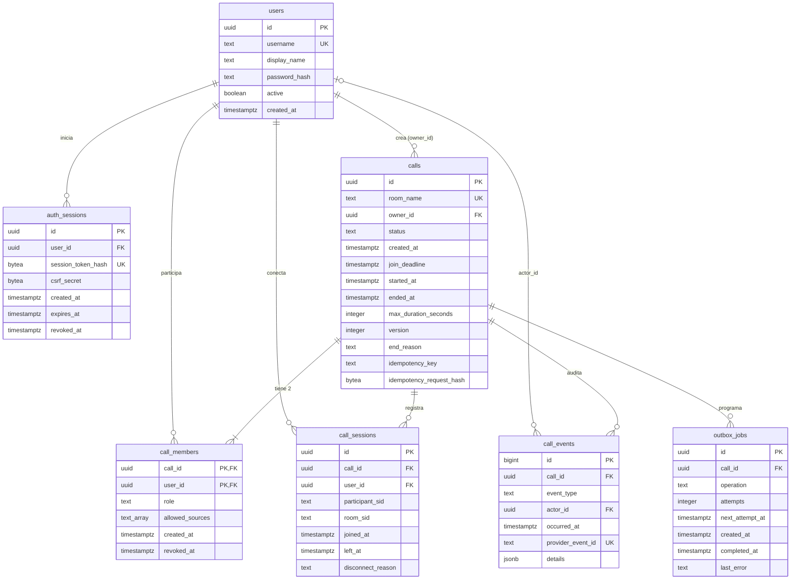

# Modelo de base de datos de la aplicación WebRTC

Versión: 1.0 · Fecha: 22 de octubre de 2026 · Basado en: `SPEC-tecnico-app-WebRTC.md` v1.2 (pasos 5, 6, 8 y 11) y `API-endpoints.md` v1.0.

Motor: PostgreSQL, con acceso mediante `pgx/v5` y migraciones SQL versionadas con `golang-migrate`. Las columnas marcadas como *(propuesta)* no figuran en los campos mínimos del spec, pero las necesitan los endpoints o los flujos documentados.

## Convenciones

- Todas las fechas son `timestamptz` y se guardan en UTC.
- Identificadores `uuid` generados por la aplicación (o con `gen_random_uuid()`).
- Los estados y roles se guardan como `text` con restricción `CHECK`. Así una migración puede agregar valores sin alterar un tipo `ENUM`.
- No se guardan tokens en claro (solo su hash), JWT de LiveKit, contraseñas ni contenido de audio o video.
- Las entidades de dominio no reflejan estas tablas: el adaptador `postgres` traduce filas a entidades (paso 3.1 del spec).

## Diagrama entidad-relación



---

## Tablas

### `users`

Usuarios locales de laboratorio. Los crea la tarea de inicialización; no hay registro público.

| Columna | Tipo | Nulo | Por defecto | Restricciones / notas |
| --- | --- | --- | --- | --- |
| `id` | `uuid` | No | | PK |
| `username` | `text` | No | | `UNIQUE`; se compara en minúsculas (`CHECK (username = lower(username))`). |
| `display_name` | `text` | No | | |
| `password_hash` | `text` | No | | Hash bcrypt. Implícito en el paso 5 del spec. |
| `active` | `boolean` | No | `true` | Solo los activos inician sesión y aparecen en `GET /users`. |
| `created_at` | `timestamptz` | No | `now()` | |

### `auth_sessions`

Sesiones de navegador asociadas a la cookie opaca.

| Columna | Tipo | Nulo | Por defecto | Restricciones / notas |
| --- | --- | --- | --- | --- |
| `id` | `uuid` | No | | PK |
| `user_id` | `uuid` | No | | FK → `users.id` `ON DELETE CASCADE` |
| `session_token_hash` | `bytea` | No | | `UNIQUE`; SHA-256 del token de la cookie. |
| `csrf_secret` | `bytea` | No | | Base del `csrfToken` que devuelve `/auth/me`. |
| `created_at` | `timestamptz` | No | `now()` | *(propuesta)* |
| `expires_at` | `timestamptz` | No | | `CHECK (expires_at > created_at)` |
| `revoked_at` | `timestamptz` | Sí | | Se llena en logout. |

Una sesión es válida si `revoked_at IS NULL AND expires_at > now()`.

### `calls`

Llamadas 1:1.

| Columna | Tipo | Nulo | Por defecto | Restricciones / notas |
| --- | --- | --- | --- | --- |
| `id` | `uuid` | No | | PK |
| `room_name` | `text` | No | | `UNIQUE`; formato `call_<uuid>`. |
| `owner_id` | `uuid` | No | | FK → `users.id` |
| `status` | `text` | No | `'CREATED'` | `CHECK (status IN ('CREATED','ACTIVE','ENDING','ENDED','CANCELLED'))` |
| `created_at` | `timestamptz` | No | `now()` | |
| `join_deadline` | `timestamptz` | No | | `created_at` + 10 min. |
| `started_at` | `timestamptz` | Sí | | Primer `participant_joined`. |
| `ended_at` | `timestamptz` | Sí | | Al pasar a `ENDED` o `CANCELLED`. |
| `max_duration_seconds` | `integer` | No | | `CHECK (max_duration_seconds > 0)`; tomado de `CALL_MAX_DURATION_SECONDS`. |
| `version` | `integer` | No | `0` | Concurrencia optimista; se incrementa en cada transición. |
| `end_reason` | `text` | Sí | | *(propuesta)* `OWNER_ENDED`, `MAX_DURATION`, `JOIN_DEADLINE`. Permite al cliente explicar el motivo. |
| `idempotency_key` | `text` | Sí | | *(propuesta)* Valor del encabezado `Idempotency-Key`. |
| `idempotency_request_hash` | `bytea` | Sí | | *(propuesta)* Hash del cuerpo, para detectar `409 IDEMPOTENCY_CONFLICT`. |

Restricciones de coherencia:

- `CHECK (status <> 'ACTIVE' OR started_at IS NOT NULL)`
- `CHECK (status NOT IN ('ENDED','CANCELLED') OR ended_at IS NOT NULL)`
- `UNIQUE (owner_id, idempotency_key)`. Los valores `NULL` no colisionan.

### `call_members`

Miembros autorizados de cada llamada: siempre el creador y un invitado.

| Columna | Tipo | Nulo | Por defecto | Restricciones / notas |
| --- | --- | --- | --- | --- |
| `call_id` | `uuid` | No | | PK compuesta; FK → `calls.id` `ON DELETE CASCADE` |
| `user_id` | `uuid` | No | | PK compuesta; FK → `users.id` |
| `role` | `text` | No | | `CHECK (role IN ('OWNER','PARTICIPANT','VIEWER'))` |
| `allowed_sources` | `text[]` | No | `'{}'` | Subconjunto de `{camera, microphone, screen_share}`; `VIEWER` siempre vacío. |
| `created_at` | `timestamptz` | No | `now()` | *(propuesta)* |
| `revoked_at` | `timestamptz` | Sí | | Un miembro revocado deja de ver la llamada y de recibir tokens. |

Restricciones:

- `PRIMARY KEY (call_id, user_id)`: unicidad por llamada y usuario.
- `UNIQUE (call_id) WHERE role = 'OWNER'` (índice parcial): un único creador por llamada.
- `CHECK (allowed_sources <@ ARRAY['camera','microphone','screen_share'])`
- `CHECK (role <> 'VIEWER' OR cardinality(allowed_sources) = 0)`

### `call_sessions`

Cada conexión real a LiveKit. Se alimenta con webhooks y con la reconciliación.

| Columna | Tipo | Nulo | Por defecto | Restricciones / notas |
| --- | --- | --- | --- | --- |
| `id` | `uuid` | No | | PK |
| `call_id` | `uuid` | No | | FK → `calls.id` `ON DELETE CASCADE` |
| `user_id` | `uuid` | No | | FK → `users.id` |
| `participant_sid` | `text` | No | | SID del participante en LiveKit. |
| `room_sid` | `text` | No | | SID de la instancia de sala; distingue salas recreadas. |
| `joined_at` | `timestamptz` | No | | |
| `left_at` | `timestamptz` | Sí | | |
| `disconnect_reason` | `text` | Sí | | Motivo de LiveKit o `RECONCILED`. |

Restricciones:

- `UNIQUE (room_sid, participant_sid)`: evita duplicar la sesión si llega un webhook repetido.
- `CHECK (left_at IS NULL OR left_at >= joined_at)`
- FK compuesta `(call_id, user_id)` → `call_members (call_id, user_id)` *(propuesta)*: solo se registran conexiones de miembros.

### `call_events`

Auditoría técnica y de negocio. También guarda los eventos de LiveKit para deduplicarlos.

| Columna | Tipo | Nulo | Por defecto | Restricciones / notas |
| --- | --- | --- | --- | --- |
| `id` | `bigint` | No | identity | PK |
| `call_id` | `uuid` | No | | FK → `calls.id` `ON DELETE CASCADE` |
| `event_type` | `text` | No | | Ver catálogo. |
| `actor_id` | `uuid` | Sí | | FK → `users.id`; `NULL` para eventos del sistema o de LiveKit. |
| `occurred_at` | `timestamptz` | No | `now()` | |
| `provider_event_id` | `text` | Sí | | `UNIQUE`; `id` del webhook de LiveKit. |
| `details` | `jsonb` | No | `'{}'` | Datos mínimos (`room_sid`, `participant_sid`, `attempt`). Nunca tokens ni contraseñas. |

Catálogo de `event_type` *(propuesta)*:

| Origen | Tipos |
| --- | --- |
| API | `CALL_CREATED`, `TOKEN_ISSUED`, `TOKEN_DENIED`, `CALL_END_REQUESTED` |
| Worker | `CALL_CANCELLED`, `CALL_MAX_DURATION`, `ROOM_DELETED`, `ROOM_DELETE_FAILED`, `CALL_ENDED`, `ROOM_RECREATED_DETECTED`, `SESSION_RECONCILED` |
| LiveKit | `LK_ROOM_STARTED`, `LK_ROOM_FINISHED`, `LK_PARTICIPANT_JOINED`, `LK_PARTICIPANT_LEFT`, `LK_TRACK_PUBLISHED`, `LK_TRACK_UNPUBLISHED` |

### `outbox_jobs`

Tareas pendientes contra LiveKit, guardadas en la misma transacción que el cambio de estado.

| Columna | Tipo | Nulo | Por defecto | Restricciones / notas |
| --- | --- | --- | --- | --- |
| `id` | `uuid` | No | | PK |
| `call_id` | `uuid` | No | | FK → `calls.id` `ON DELETE CASCADE` |
| `operation` | `text` | No | | `CHECK (operation IN ('DELETE_ROOM'))`; se amplía por migración. |
| `attempts` | `integer` | No | `0` | `CHECK (attempts >= 0)` |
| `next_attempt_at` | `timestamptz` | No | `now()` | Backoff exponencial con tope. |
| `created_at` | `timestamptz` | No | `now()` | *(propuesta)* |
| `completed_at` | `timestamptz` | Sí | | |
| `last_error` | `text` | Sí | | *(propuesta)* Mensaje técnico truncado, sin secretos. |

Restricción: `UNIQUE (call_id, operation) WHERE completed_at IS NULL` (índice parcial). Así no se duplica una tarea pendiente si `/end` se repite o el worker la crea durante la reconciliación.

---

## Índices

| Tabla | Índice | Uso |
| --- | --- | --- |
| `users` | `UNIQUE (username)` | Login. |
| `auth_sessions` | `UNIQUE (session_token_hash)` | Validar cookie en cada solicitud. |
| `auth_sessions` | `(user_id)` | Revocar sesiones de un usuario. |
| `auth_sessions` | `(expires_at)` | Purga de sesiones vencidas. |
| `calls` | `UNIQUE (room_name)` | Resolver webhooks y reconciliación. |
| `calls` | `UNIQUE (owner_id, idempotency_key)` | `Idempotency-Key` en `POST /calls`. |
| `calls` | `(status, join_deadline) WHERE status = 'CREATED'` | Cancelar llamadas vencidas. |
| `calls` | `(status, started_at) WHERE status = 'ACTIVE'` | Detectar duración máxima superada. |
| `call_members` | `PK (call_id, user_id)` | Autorización por llamada. |
| `call_members` | `(user_id)` | Llamadas de un usuario. |
| `call_members` | `UNIQUE (call_id) WHERE role = 'OWNER'` | Un único creador. |
| `call_sessions` | `UNIQUE (room_sid, participant_sid)` | Deduplicación. |
| `call_sessions` | `(call_id) WHERE left_at IS NULL` | Sesiones abiertas para reconciliar. |
| `call_events` | `UNIQUE (provider_event_id)` | Deduplicar webhooks. |
| `call_events` | `(call_id, occurred_at)` | Auditoría por llamada. |
| `call_events` | `(occurred_at)` | Retención de 30 días. |
| `outbox_jobs` | `(next_attempt_at) WHERE completed_at IS NULL` | Selección de tareas del worker. |
| `outbox_jobs` | `UNIQUE (call_id, operation) WHERE completed_at IS NULL` | Una tarea pendiente por operación. |

---

## Transacciones y concurrencia

| Operación | Contenido de la transacción | Bloqueo |
| --- | --- | --- |
| Login | `INSERT auth_sessions` | Ninguno. |
| Logout | `UPDATE auth_sessions SET revoked_at` | Ninguno. |
| `POST /calls` | `INSERT calls` + 2 × `INSERT call_members` + `INSERT call_events` | `UNIQUE (owner_id, idempotency_key)` resuelve carreras de reintento. |
| `POST /join-token` | Validar miembro y estado + `INSERT call_events TOKEN_ISSUED` | `SELECT ... FROM calls WHERE id = $1 FOR UPDATE`: se serializa con el cierre. Las llamadas a LiveKit (asegurar sala y firmar el token) ocurren fuera de la transacción. |
| `POST /end` | `UPDATE calls SET status = 'ENDING', version = version + 1` + `INSERT outbox_jobs` + `INSERT call_events` | `FOR UPDATE` sobre `calls`. |
| Webhook | `INSERT call_events` (deduplicación) + cambios en `call_sessions` y `calls` | `FOR UPDATE` sobre `calls` si cambia el estado. |
| Worker: tomar tareas | `SELECT ... FROM outbox_jobs WHERE completed_at IS NULL AND next_attempt_at <= now() FOR UPDATE SKIP LOCKED` | Evita doble procesamiento si en el futuro hubiera varias instancias. |
| Worker: completar cierre | `UPDATE calls SET status = 'ENDED', ended_at` + `UPDATE outbox_jobs SET completed_at` + `INSERT call_events` | `FOR UPDATE` sobre `calls`. |

Todas las transiciones se escriben con una condición sobre el estado de origen, por ejemplo:

```sql
UPDATE calls
SET status = 'ENDING', version = version + 1
WHERE id = $1 AND status IN ('CREATED', 'ACTIVE');
```

Si no se actualiza ninguna fila, el caso de uso relee el estado y responde de forma idempotente (`202`) o con conflicto (`409`). Esto impide que un evento tardío reabra una llamada terminada.

### Transiciones de estado permitidas

| Desde | Hacia | Disparador | Columnas afectadas |
| --- | --- | --- | --- |
| — | `CREATED` | `POST /calls` | `created_at`, `join_deadline` |
| `CREATED` | `ACTIVE` | Primer `participant_joined` o reconciliación | `started_at` |
| `CREATED` | `CANCELLED` | Worker: `join_deadline` vencido sin sesiones | `ended_at`, `end_reason = 'JOIN_DEADLINE'` |
| `CREATED`, `ACTIVE` | `ENDING` | `POST /end` del creador | `end_reason = 'OWNER_ENDED'` + `outbox_jobs` |
| `ACTIVE` | `ENDING` | Worker: duración máxima superada | `end_reason = 'MAX_DURATION'` + `outbox_jobs` |
| `ENDING` | `ENDED` | `DeleteRoom` confirmado, sala ausente o `room_finished` | `ended_at`, `outbox_jobs.completed_at` |

Cualquier otra transición se rechaza en el dominio y, como respaldo, en la condición `WHERE` del `UPDATE`.

---

## Retención y mantenimiento

| Dato | Retención *(propuesta)* | Mecanismo |
| --- | --- | --- |
| `auth_sessions` vencidas o revocadas | 7 días | Purga periódica del worker. |
| `call_events` | 30 días, configurable | Purga por `occurred_at`. |
| `outbox_jobs` completadas | 30 días | Purga por `completed_at`. |
| `calls`, `call_members`, `call_sessions` | Mientras dure el laboratorio | Reinicio explícito del laboratorio. |

- **Respaldo:** `pg_dump` del volumen nombrado de PostgreSQL antes de reiniciar los datos.
- **Reinicio de datos:** acción separada y explícita (borrar el volumen y volver a ejecutar las migraciones y la carga de usuarios). Nunca forma parte del `down` habitual.
- **Migraciones sugeridas:**
  1. `000001_users_and_sessions`: `users`, `auth_sessions`.
  2. `000002_calls`: `calls`, `call_members`.
  3. `000003_call_tracking`: `call_sessions`, `call_events`.
  4. `000004_outbox`: `outbox_jobs`.
