# Diagramas de flujo de la aplicación WebRTC

Versión: 1.0 · Fecha: 22 de octubre de 2026 · Basado en: `SPEC-tecnico-app-WebRTC.md` v1.2 y `API-endpoints.md` v1.0.

Los diagramas usan Mermaid. Participantes comunes:

| Nombre | Componente |
| --- | --- |
| `UI` | Componentes y presenter/store Svelte. |
| `UC` | Casos de uso del frontend (`SignIn`, `JoinCall`, `EndCall`, etc.). |
| `MS` | Adaptador `MediaSession` sobre `livekit-client`. |
| `Caddy` | Proxy HTTPS/WSS y servidor de la SPA. |
| `API` | Backend Go (handlers + casos de uso). |
| `DB` | PostgreSQL. |
| `LK` | LiveKit (SFU + TURN integrado). |
| `Worker` | Goroutine de cierres y reconciliación dentro del servicio Go. |

## Índice

1. [Vista general de rutas](#1-vista-general-de-rutas)
2. [Inicio de sesión](#2-inicio-de-sesión)
3. [Cierre de sesión](#3-cierre-de-sesión)
4. [Crear llamada e invitar](#4-crear-llamada-e-invitar)
5. [Abrir el enlace y antesala](#5-abrir-el-enlace-y-antesala)
6. [Unirse a la llamada](#6-unirse-a-la-llamada)
7. [Emisión del join-token (decisión en el backend)](#7-emisión-del-join-token-decisión-en-el-backend)
8. [Controles de cámara, micrófono y pantalla](#8-controles-de-cámara-micrófono-y-pantalla)
9. [Reconexión](#9-reconexión)
10. [Salir de la llamada](#10-salir-de-la-llamada)
11. [Finalizar para todos](#11-finalizar-para-todos)
12. [Procesamiento de webhooks](#12-procesamiento-de-webhooks)
13. [Trabajador de cierres y reconciliación](#13-trabajador-de-cierres-y-reconciliación)
14. [Ciclo de vida de la llamada](#14-ciclo-de-vida-de-la-llamada)
15. [Estados de la interfaz](#15-estados-de-la-interfaz)

---

## 1. Vista general de rutas

Separa las tres rutas: negocio (HTTPS `/api`), señalización (WSS) y medios (WebRTC UDP/TCP o TURN).

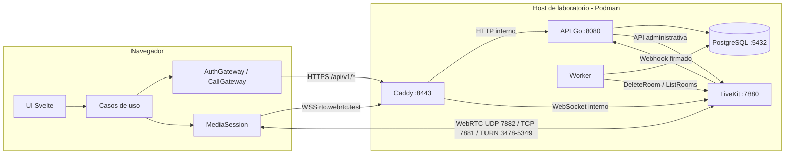

---

## 2. Inicio de sesión

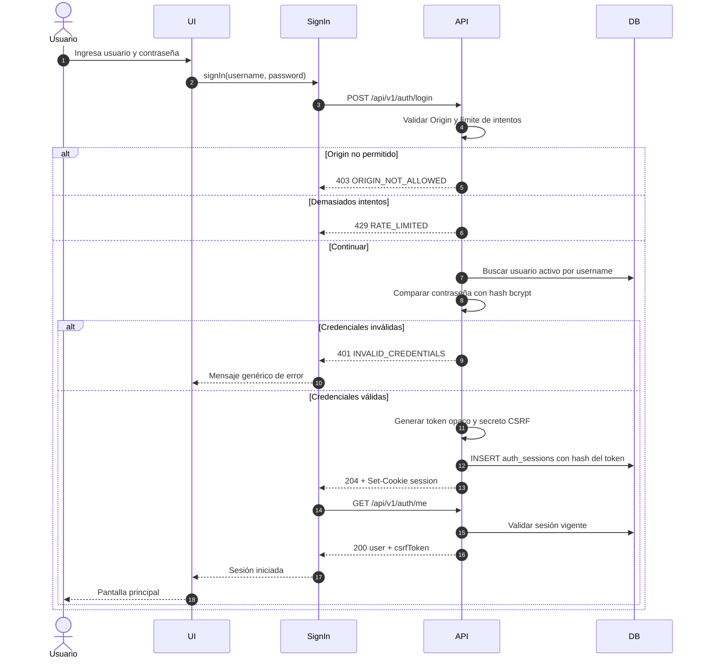

---

## 3. Cierre de sesión

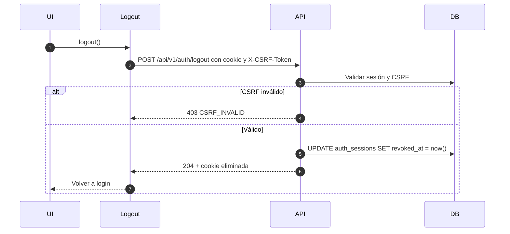

---

## 4. Crear llamada e invitar

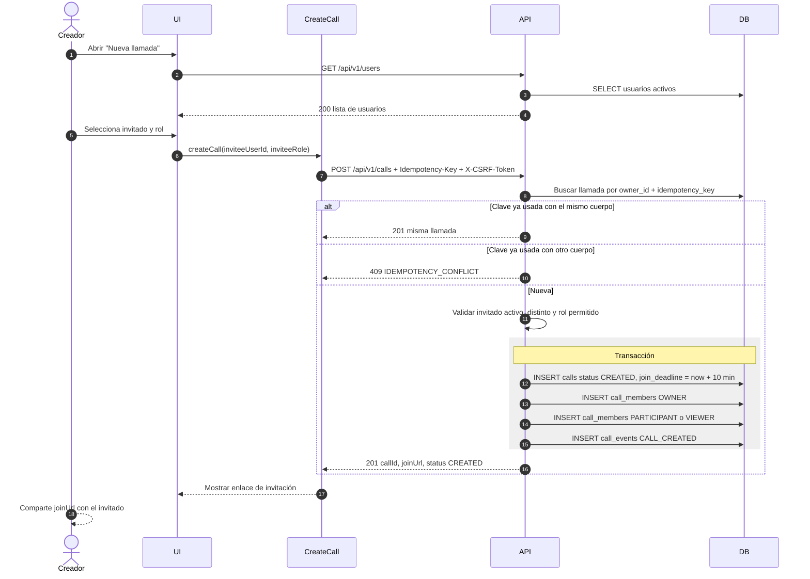

---

## 5. Abrir el enlace y antesala

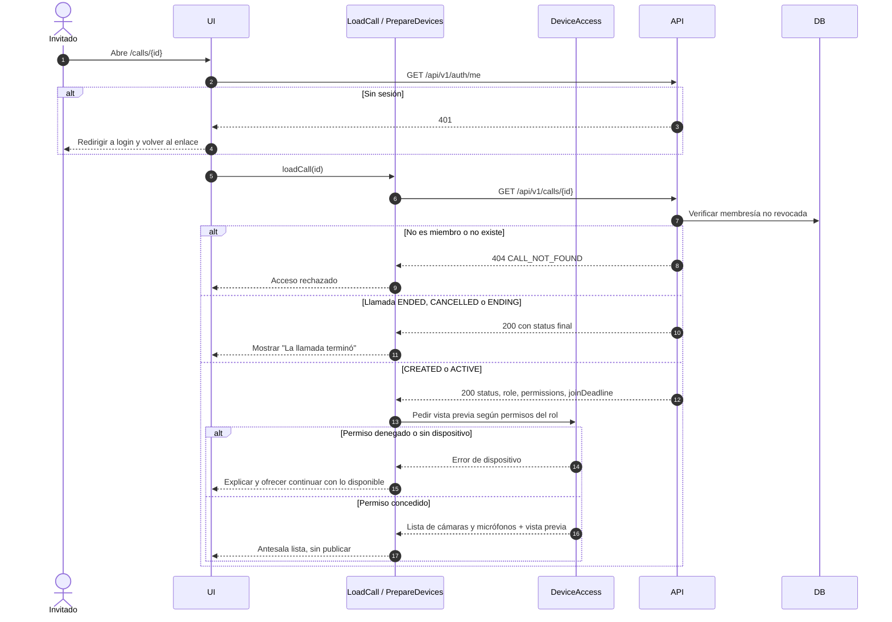

---

## 6. Unirse a la llamada

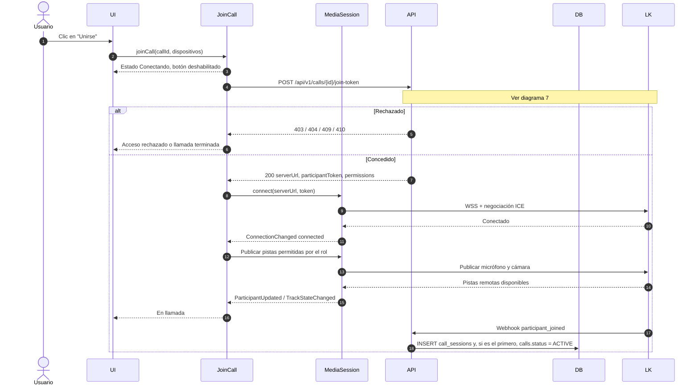

---

## 7. Emisión del join-token (decisión en el backend)

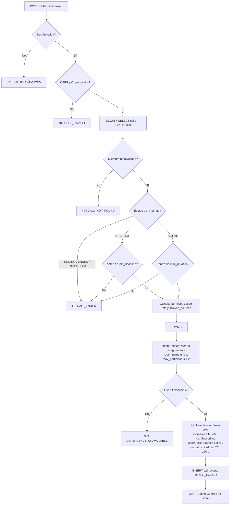

---

## 8. Controles de cámara, micrófono y pantalla

### 8.1. Cámara y micrófono

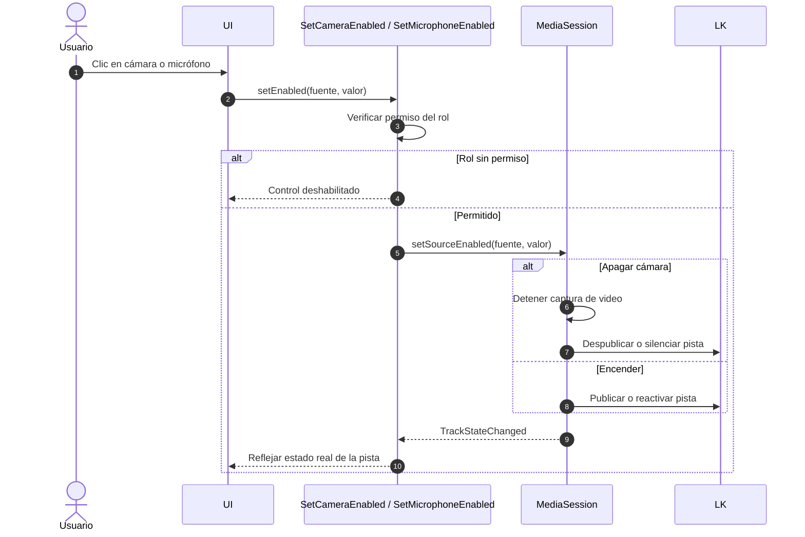

### 8.2. Compartir pantalla

El clic invoca el caso de uso y este llama al puerto de captura de inmediato, sin esperas de red previas, para conservar la activación del usuario.

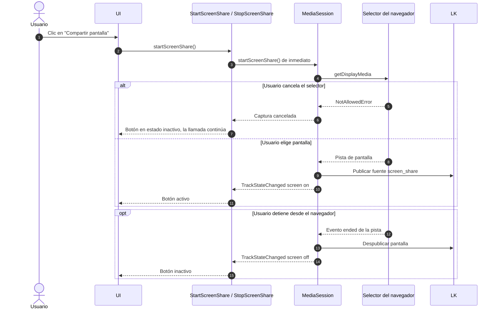

---

## 9. Reconexión

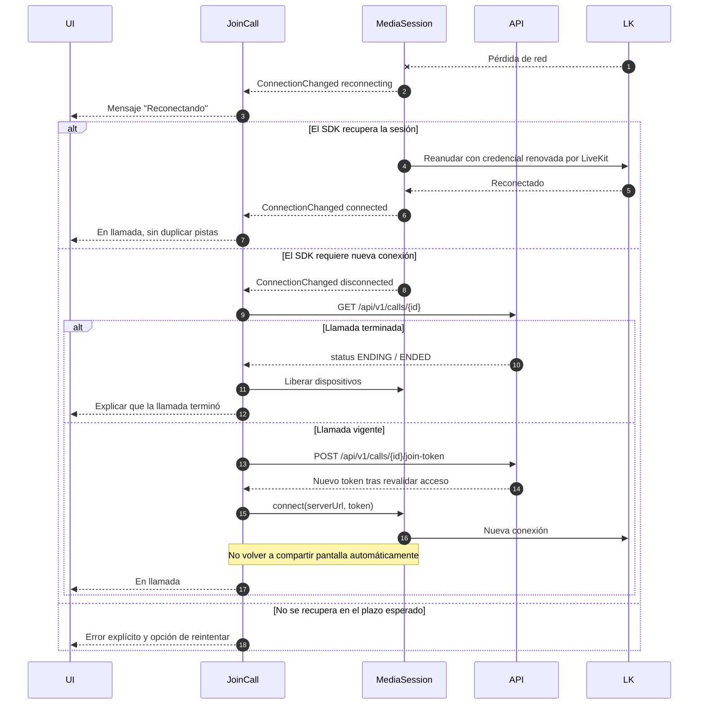

---

## 10. Salir de la llamada

"Salir" solo afecta al usuario actual; no cambia el estado de la llamada.

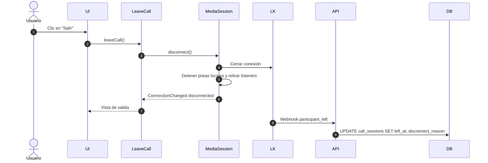

---

## 11. Finalizar para todos

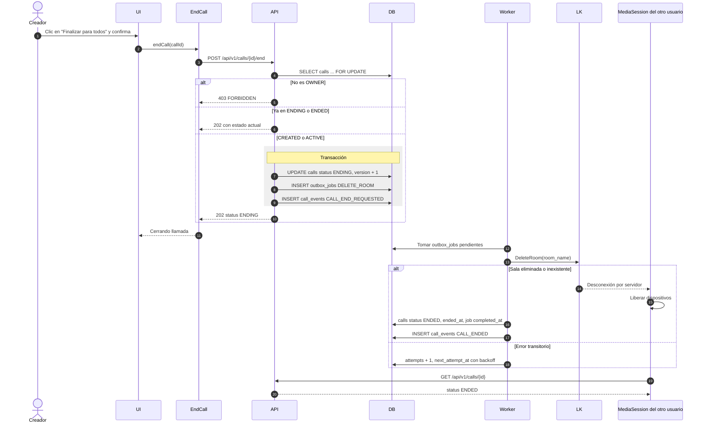

---

## 12. Procesamiento de webhooks

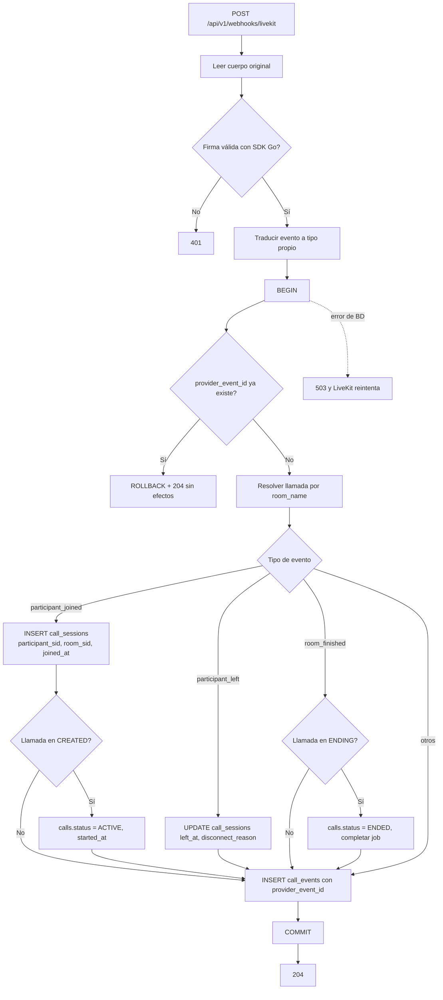

Regla transversal: un evento nunca mueve una llamada de `ENDING`, `ENDED` o `CANCELLED` a un estado anterior.

---

## 13. Trabajador de cierres y reconciliación

Goroutine única del servicio Go, con cancelación por contexto y apagado ordenado.

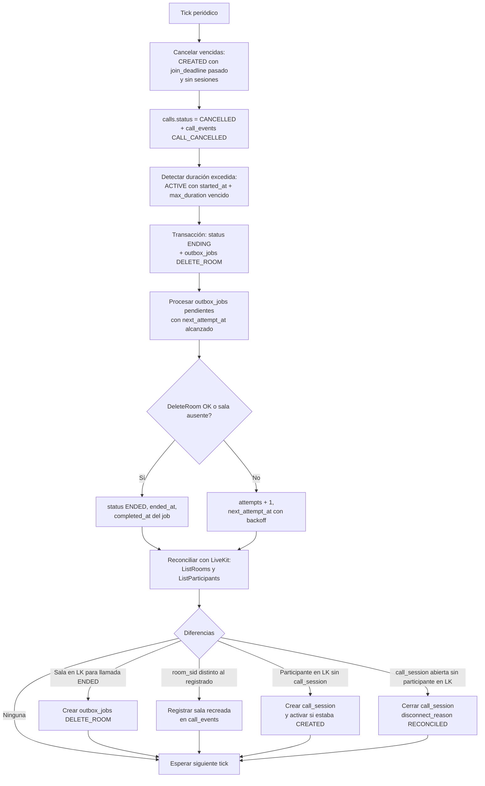

---

## 14. Ciclo de vida de la llamada

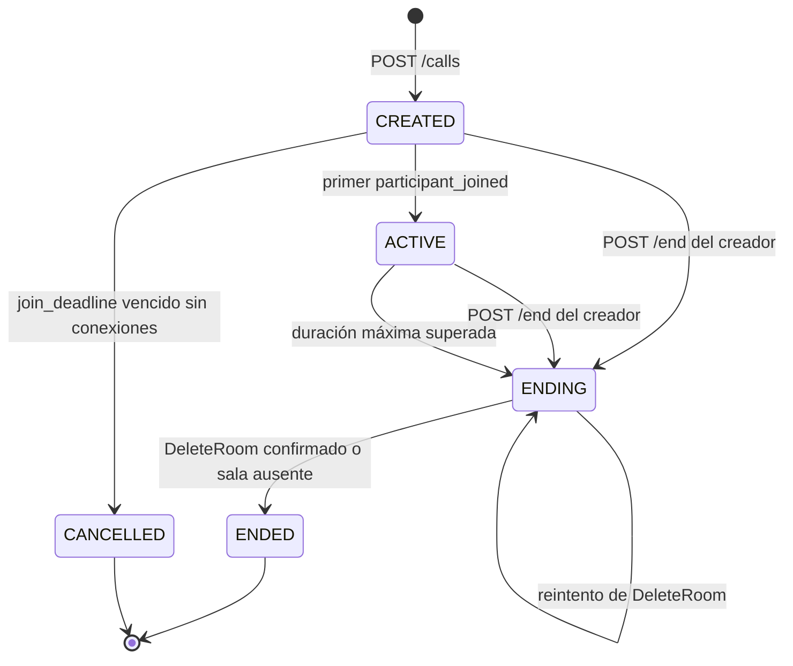

| Estado | Emite tokens | Acepta `/end` |
| --- | --- | --- |
| `CREATED` | Sí, antes de `join_deadline` | Sí |
| `ACTIVE` | Sí, dentro de la duración máxima | Sí |
| `ENDING` | No (`410`) | Sí, idempotente |
| `ENDED` | No (`410`) | Sí, idempotente |
| `CANCELLED` | No (`410`) | No (`409`) |

---

## 15. Estados de la interfaz

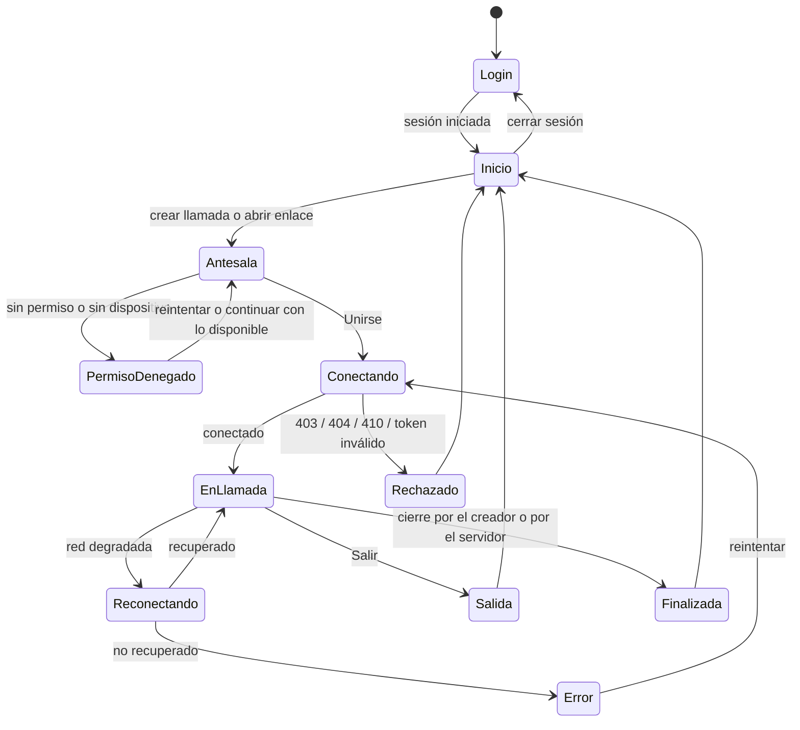

Al entrar en `Rechazado`, `Salida`, `Finalizada` o `Error`, la app detiene las capturas, libera los dispositivos y explica la causa.
